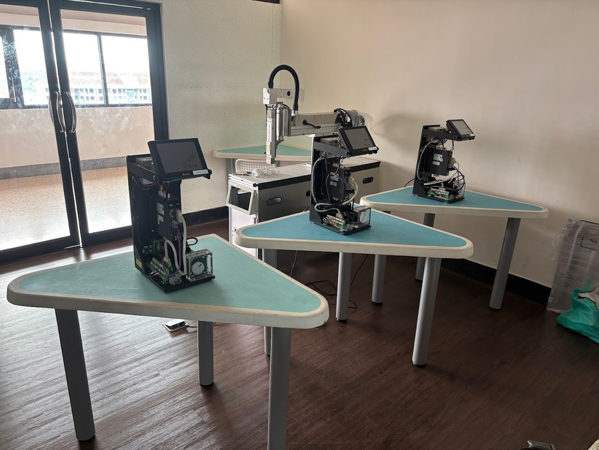
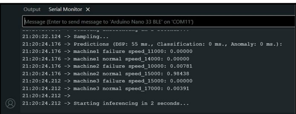

# TinyML Machine Failure Detection

On-device vibration classification with an **Arduino Nano 33 BLE Sense**. The board is mounted on a motor drive unit and detects, in real time, **which machine** it is on, whether that machine is **normal or failing**, and the **motor speed** it is running at. Everything runs on the microcontroller and needs no cloud connection.

Built with [Edge Impulse](https://edgeimpulse.com/) as the TinyML Mini Project for *01416516 Robotics Laboratory 3* at KMITL (Department of Robotics and AI Engineering).



## How it works

1. **Mounting:** a custom 3D-printed enclosure holds the Nano 33 BLE Sense rigidly on the motor casing, so motor vibration reaches the IMU directly. Sensor position and orientation stay fixed for every recording.
2. **Data collection:** the motor speed is held constant through the drive controller while vibration data is recorded for each machine in a normal and a simulated-failure condition (for example, a loosened component). That gave 5 minutes of data, split 80/20 into training and test sets.
3. **Signal processing:** **accZ + gyrZ** are sampled at **100 Hz** in 2-second windows and passed through a **spectral analysis** block.
4. **Classification:** a small neural network classifies each window into one of 6 classes.

| Class | Machine | Condition | Speed |
|---|---|---|---|
| `machine1 failure speed_11000` | 1 | Failure | 11000 |
| `machine1 normal speed_14000`  | 1 | Normal  | 14000 |
| `machine2 failure speed_10000` | 2 | Failure | 10000 |
| `machine2 normal speed_15000`  | 2 | Normal  | 15000 |
| `machine3 failure speed_15000` | 3 | Failure | 15000 |
| `machine3 normal speed_17000`  | 3 | Normal  | 17000 |

## Results

- **Test accuracy:** 97.56%. Every class was classified 100% correctly except `machine2 failure`, which was 85.4% correct; the remaining 14.6% of its windows were rated *uncertain*, not assigned to the wrong class.
- **On-device:** ~1 ms inference, 1.4 KB peak RAM, 15 KB flash (EON Compiler). The DSP step takes ~55 ms per window.
- The Feature Explorer shows well-separated clusters per class. Classes recorded at similar motor speeds sit closer together, so speed-dependent vibration components drive much of the decision.

Live inference on the Serial Monitor (this window was taken on machine 2 running normally):



### Demo videos

1. https://youtube.com/shorts/bdOnfGldWxM
2. https://youtube.com/shorts/VKJgRKDy1Xo
3. https://youtube.com/shorts/mY1eKxZ4kes

## Run it yourself

1. Zip the [`final_project_inferencing`](final_project_inferencing/) folder, then in the Arduino IDE go to **Sketch → Include Library → Add .ZIP Library…**.
2. Install the **Arduino Mbed OS Nano Boards** core and the sensor libraries for your board revision:
   - Rev1: `Arduino_LSM9DS1`, `Arduino_LPS22HB`, `Arduino_HTS221`, `Arduino_APDS9960`
   - Rev2: `Arduino_BMI270_BMM150`, `Arduino_LPS22HB`, `Arduino_HS300x`, `Arduino_APDS9960`
3. Open **File → Examples → final_project_inferencing → nano_ble33_sense → nano_ble33_sense_fusion** (Rev2: `nano_ble33_sense_rev2 → nano_ble33_sense_rev2_fusion`).
4. Upload the sketch, open the Serial Monitor at **115200 baud**, and mount the board on the motor the same way it was mounted during training.

## Repository layout

```
final_project_inferencing/   Edge Impulse Arduino library (v1.0.5): model, DSP and SDK
  examples/                  Ready-to-flash sketches for supported boards
  src/model-parameters/      Labels, window size and DSP configuration
  src/tflite-model/          Compiled neural network
images/                      Setup photo and serial monitor screenshots
```

## Authors

Hsu Myat Noe and Jin Somaang. Instructor: Dr. Sarucha Yanyong.
